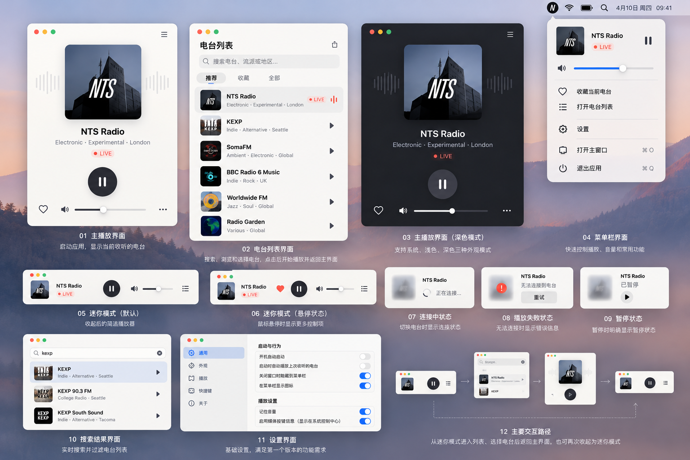

# Radio 首个 To C 版本 UI 定义

> 范围：界面、界面功能、展示信息与跳转关系。参考图中的电台名称和封面仅作示意。

## 1. 首版界面

首版包含五个界面：主播放器、电台列表、迷你播放器、菜单栏面板、设置。

### 1.1 主播放器

**展示信息**
- 当前电台封面、名称、类型/地区。
- 播放状态：连接中、直播中、已暂停或播放失败。
- 当前曲目信息（电台有提供时显示）。

**功能**
- 播放/暂停、收藏/取消收藏、音量调节/静音。
- 打开电台列表、切换迷你播放器。
- 播放失败时重试。

**不包含**：上一首、下一首、播放进度条。

### 1.2 电台列表

**展示信息**
- 推荐、收藏、全部三个分类。
- 搜索结果及电台封面、名称、类型/地区；当前播放电台有状态标识。
- 加载中、无搜索结果、无收藏、加载失败等状态。

**功能**
- 按名称、类型、地区搜索。
- 浏览推荐/收藏/全部电台。
- 选择电台后立即播放；收藏或取消收藏。

### 1.3 迷你播放器

**默认展示**：电台封面、名称、播放状态、播放/暂停按钮。

**悬停后展示**：收藏、音量、打开电台列表、恢复主播放器。

迷你播放器与主播放器共享当前电台和播放状态，切换形态时不中断播放。

### 1.4 菜单栏面板

**展示信息**：当前电台、播放状态、音量。

**功能**：播放/暂停、调节音量、收藏/取消收藏、打开主窗口、打开设置、退出应用。关闭主窗口后仍可从菜单栏控制播放。

### 1.5 设置

设置项按以下类别展示：
- **通用**：开机启动（默认关闭）、启动时自动播放（默认关闭）、关闭窗口后的行为。
- **播放**：记住音量。
- **快捷键**：播放/暂停等快捷键。

首版不提供应用内外观切换，界面跟随 macOS 外观。

## 2. 页面跳转与窗口关系

```text
启动应用
  └─> 主播放器
       ├─> 电台列表 ──选择电台──> 主播放器（新电台开始播放）
       ├─> 迷你播放器 ──展开────> 主播放器
       └─> 设置

菜单栏面板
  ├─> 播放/暂停、音量、收藏（留在面板）
  ├─> 打开主窗口 ─────────────> 主播放器
  ├─> 电台列表 ──选择电台────> 主播放器（新电台开始播放）
  └─> 设置
```

- 启动时恢复上次电台；是否自动播放由设置决定。
- 主播放器、迷你播放器和菜单栏控制同一个播放会话。
- 关闭主窗口不等于退出应用；退出应用会停止播放。

## 3. 全局播放状态

| 状态 | 显示内容 | 可用操作 |
|---|---|---|
| 连接中 | 连接提示/进度 | 可切换电台 |
| 直播中 | 直播标识 | 暂停、收藏、调节音量 |
| 已暂停 | 暂停标识 | 播放 |
| 播放失败 | 失败提示 | 重试、切换电台 |

同一状态在主播放器、迷你播放器、菜单栏中保持一致。目录加载和搜索结果状态仅显示在电台列表。

## 4. 界面参考

参考图中的浅色/深色模式切换不纳入首版；首版跟随 macOS 外观。


